<div align="center">

[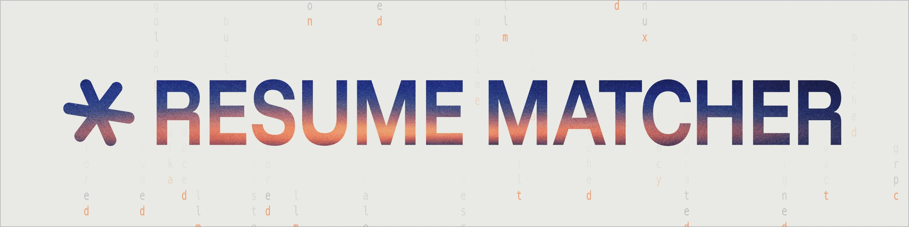](https://resumematcher.fyi/)

# Resume Matcher

[English](README.md) | [Español](README.es.md) | **简体中文** | [日本語](README.ja.md)

[𝙹𝚘𝚒𝚗 𝙳𝚒𝚜𝚌𝚘𝚛𝚍](https://dsc.gg/resume-matcher) ✦ [𝚆𝚎𝚋𝚜𝚒𝚝𝚎](https://resumematcher.fyi/) ✦ [𝙷𝚘𝚠 𝚝𝚘 𝙸𝚗𝚜𝚝𝚊𝚕𝚕](https://resumematcher.fyi/docs/installation/) ✦ [𝙲𝚘𝚗𝚝𝚛𝚒𝚋𝚞𝚝𝚘𝚛𝚜](#contributors) ✦ [𝚂𝚙𝚘𝚗𝚜𝚘𝚛](#sponsors) ✦ [𝚃𝚠𝚒𝚝𝚝𝚎𝚛/𝚇](https://twitter.com/srbhr_r) ✦ [𝙻𝚒𝚗𝚔𝚎𝚍𝙸𝚗](https://www.linkedin.com/company/resume-matcher/) ✦ [𝙲𝚛𝚎𝚊𝚝𝚘𝚛](https://srbhr.com)

免费开源简历生成器：根据每一份职位描述（JD）定制你的简历。自托管的 AI 工具，支持 Claude、ChatGPT、DeepSeek、Kimi、GLM、Gemma 等本地或云端 LLM。


</div>

<br>

<div align="center">


  

[](https://dsc.gg/resume-matcher) [](https://resumematcher.fyi/) [](https://www.linkedin.com/company/resume-matcher/)

<a href="https://trendshift.io/repositories/565" target="_blank"></a>


</div>

> \[!IMPORTANT]
>
> 本项目需要你的帮助与支持。如果你能捐赠一点点，就能帮助我持续开发和改进 Resume Matcher。

<div align="center">

[](https://github.com/sponsors/srbhr) [](https://www.buymeacoffee.com/srbhr)

**代表公司赞助？** 让你的 Logo 展示在 27k+ 开发者面前 → **[成为赞助商 ↓](#sponsors)**

</div>

## 快速开始

Resume Matcher 的工作方式是先建立一份“主简历”，然后针对每个职位描述进行定制。安装说明见：[如何安装](#how-to-install)

### 工作流程

1. **上传**你的主简历（PDF 或 DOCX）
2. **粘贴**你要投递的职位描述（JD）
3. **审阅**AI 生成的改进建议与定制内容
4. **生成**该岗位的求职信与邮件模板
5. **自定义**版式与章节，匹配你的风格
6. **导出**为你选定模板的专业 PDF

### 为软件工程师打造

安装 Resume Matcher 需要用到终端，所以大多数使用者本身就是写代码的人。它贴合你已有的工作方式：

- **在你自己的电脑上运行。** FastAPI 后端、Next.js 前端和一个 SQLite 文件。克隆仓库，或启动一个 Docker 容器即可。无需注册账号，简历只保存在你自己的数据库里。
- **模型由你选择。** 使用 OpenAI、Anthropic、Gemini、DeepSeek、OpenRouter 或 Groq 的 API Key，或通过 Ollama 运行本地模型，让简历始终不离开你的电脑。
- **可以由 Claude Code 驱动。** 通过 [MCP 服务器](SETUP.zh-CN.md#在-claude-code-或-claude-desktop-中使用-resume-matchermcp)，Claude Code、Cursor 或 Codex 负责撰写定制简历，Resume Matcher 负责保存、检查和渲染，无需 LLM API Key。
- **只基于你的真实经历。** 定制提示词禁止添加主简历中没有的技能、工具、公司或量化数据。
- **评分逻辑是可读的代码。** ATS 评分（[`services/ats.py`](apps/backend/app/services/ats.py)）和 ATS 检查（[`services/ats_parse/`](apps/backend/app/services/ats_parse/)）都不调用 LLM。ATS 检查用 pdfminer 读取你的 PDF，展示招聘系统（ATS）能提取到的内容。
- **模板就是工程师常用的样式。** 除了单栏和双栏模板，还有 Deedy、Modern Deedy 和 LaTeX 风格版式。其中七套设计另有可编辑的 pdfLaTeX 项目，可直接导入 Overleaf：[resume-matcher-templates](https://github.com/resume-matcher/resume-matcher-templates)。

### 保持联系

[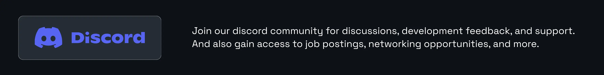](https://dsc.gg/resume-matcher)

加入我们的 [Discord](https://dsc.gg/resume-matcher)，参与讨论、功能需求与社区支持。

[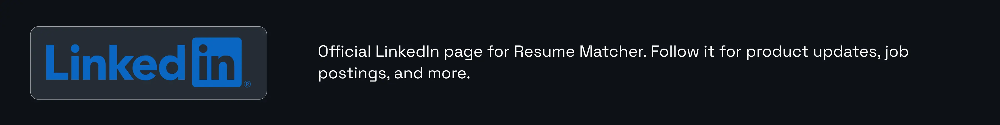](https://www.linkedin.com/company/resume-matcher/)

关注我们的 [LinkedIn](https://www.linkedin.com/company/resume-matcher/) 获取更新。

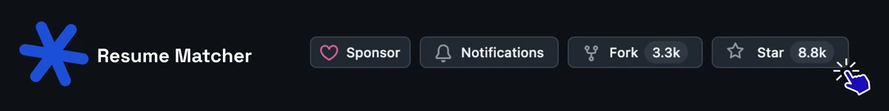

给仓库点 Star 来支持开发，并及时获取新版本通知。

<a id="sponsors"></a>

## 赞助商

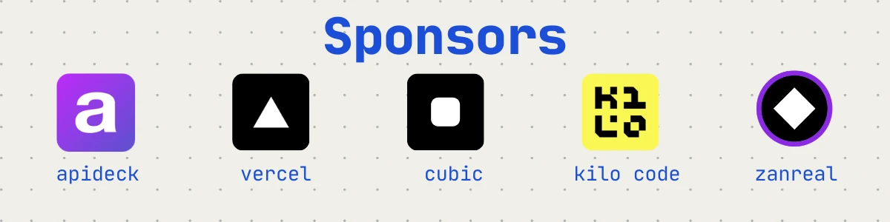

Resume Matcher 是免费且开源的，依靠赞助商与支持者维持运转。如果它对你有帮助，欢迎支持它的开发。

### 支持 Resume Matcher 的公司

以公司档位赞助，**你的 Logo + 链接 + 简介将展示在这里** —— 面向 **27k+ Star、4.9k Fork** 的社区，并登上 [Trendshift](https://trendshift.io/repositories/565) 与 [Vercel OSS 计划](https://vercel.com/oss)。

| Sponsor | Description |
|---------|-------------|
| [APIDECK](https://apideck.com?utm_source=resumematcher&utm_medium=github&utm_campaign=sponsors) | One API to connect your app to 200+ SaaS platforms (accounting, HRIS, CRM, file storage). Build integrations once, not 50 times. 🌐 [apideck.com](https://apideck.com?utm_source=resumematcher&utm_medium=github&utm_campaign=sponsors) |
| [Vercel](https://vercel.com?utm_source=resumematcher&utm_medium=github&utm_campaign=sponsors) | Resume Matcher 是 Vercel OSS // Summer 2025 计划的一部分 🌐 [vercel.com](https://vercel.com?utm_source=resumematcher&utm_medium=github&utm_campaign=sponsors) |
| [Cubic.dev](https://cubic.dev?utm_source=resumematcher&utm_medium=github&utm_campaign=sponsors) | Cubic 为 Resume Matcher 提供 PR 审查 🌐 [cubic.dev](https://cubic.dev?utm_source=resumematcher&utm_medium=github&utm_campaign=sponsors) |
| [Kilo Code](https://kilo.ai?utm_source=resumematcher&utm_medium=github&utm_campaign=sponsors) | Kilo Code 为 Resume Matcher 提供 AI 代码审查和编码积分 🌐 [kilo.ai](https://kilo.ai?utm_source=resumematcher&utm_medium=github&utm_campaign=sponsors) |
| [ZanReal](https://zanreal.com/?utm_source=resumematcher&utm_medium=github&utm_campaign=sponsors) | ZanReal 是一家以 AI 驱动的开发公司，构建可扩展的云解决方案，从战略、UX 到 DevOps，帮助团队更快交付、把创意变为产品。 🌐 [zanreal.com](https://zanreal.com/?utm_source=resumematcher&utm_medium=github&utm_campaign=sponsors) |
| **✦ 你的公司可展示于此** | 触达 27k+ 开发者与 4.9k Fork。**[成为赞助商 →](https://github.com/sponsors/srbhr)** |

请阅读我们的 [Sponsorship Guide](https://resumematcher.fyi/docs/sponsoring/) 了解您的赞助如何帮助本项目。您将在 ReadME 和我们的网站上获得特别鸣谢。

<a id="support-the-development-by-donating"></a>

### 以个人身份支持


每一份支持都让 Resume Matcher 保持免费，并资助新功能的开发 —— 你也会在 ReadME 和我们的网站上获得鸣谢。

| 平台  | 链接 |
|------|------|
| GitHub | [](https://github.com/sponsors/srbhr) |
| Buy Me a Coffee | [](https://www.buymeacoffee.com/srbhr) |

## 创作者留言

感谢您关注 Resume Matcher。如果您想联系、合作或只是打个招呼，请随时联系我！
~ **Saurabh Rai** ✨

您可以在以下平台关注我：

- Website: [https://srbhr.com](https://srbhr.com)
- Linkedin: [https://www.linkedin.com/in/srbhr/](https://www.linkedin.com/in/srbhr/)
- Twitter: [https://twitter.com/srbhr_r](https://twitter.com/srbhr_r)
- GitHub: [https://github.com/srbhr](https://github.com/srbhr)

## 主要功能

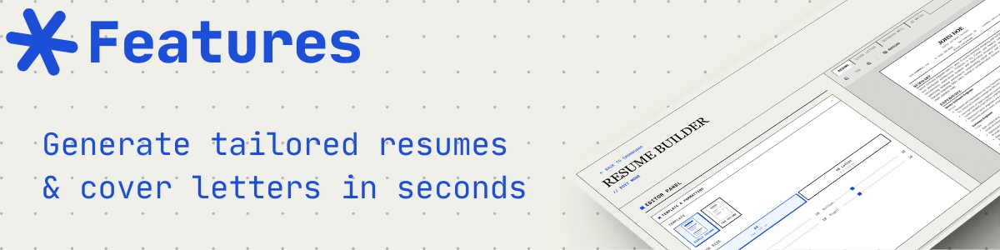

### 核心能力

**主简历（Master Resume）**：基于你现有简历创建一份完整的主简历，后续每次投递都从这份主简历中抽取与定制。

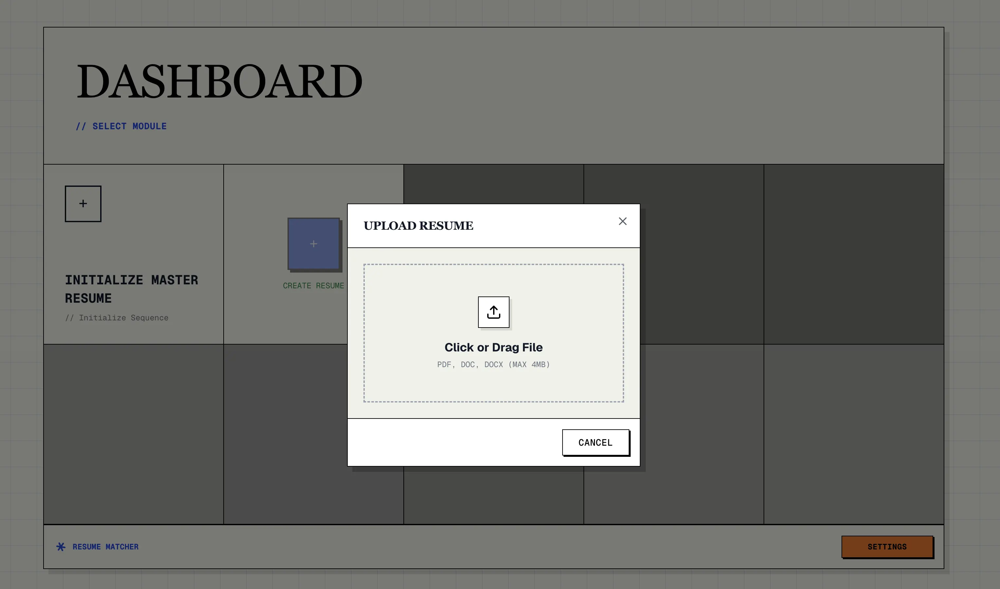

### 简历生成器

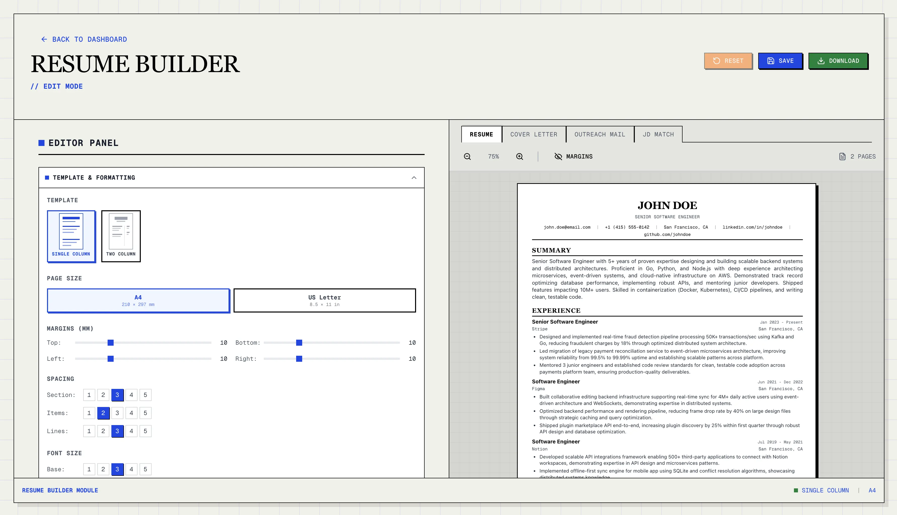

粘贴职位描述后，获得针对该岗位定制的 AI 简历建议。

你可以：

- 修改建议内容
- 添加/移除章节
- 通过拖拽调整章节顺序
- 从多种简历模板中选择

### 求职信与邮件生成器

基于职位描述与你的简历，生成定制化的求职信与邮件模板。

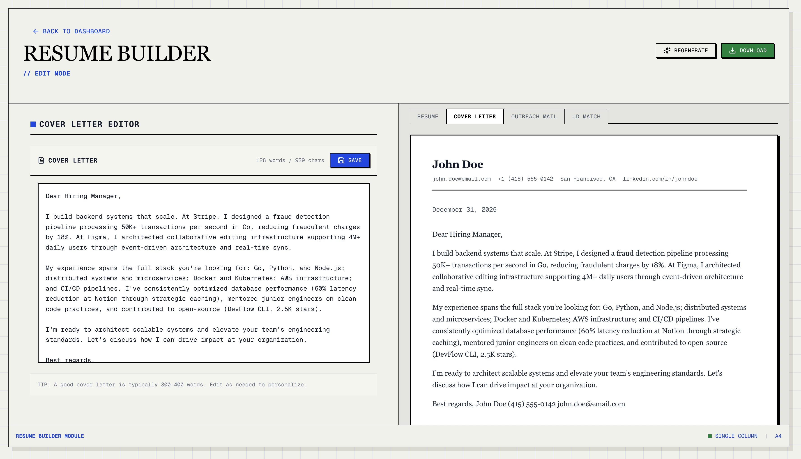

### ATS 评分、ATS 检查与关键词高亮

「JD 匹配」标签页把职位描述和你的简历并排显示，高亮共同的关键词，并给出满分 100 的 **ATS 评分**：关键词匹配（40%）、技能覆盖（20%）、职位名称匹配（15%）、板块完整度（15%）和日期格式一致性（10%）。它会列出缺失的关键词，以及主简历里已有的关键词，这些可以直接加回来，不会编造内容。

**ATS 检查**标签页会生成你的 PDF，像招聘系统（ATS）的文本提取器那样把文字读回来，报告可读性、阅读顺序、联系方式和板块标题。两者都由普通代码计算。[什么是 ATS 分数？](https://resumematcher.fyi/zh/blog/what-is-an-ats-score/)讲了具体公式。

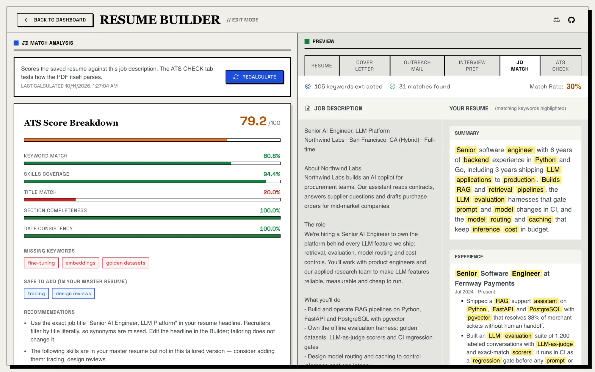

### PDF 导出

将定制后的简历与求职信导出为 PDF。

### 模板

所有模板导出的都是带文本层的 PDF（A4 或 US Letter），招聘系统（ATS）可以正常解析。

| 模板名称 | 预览 | 说明 |
|---------|------|------|
| **单栏** | 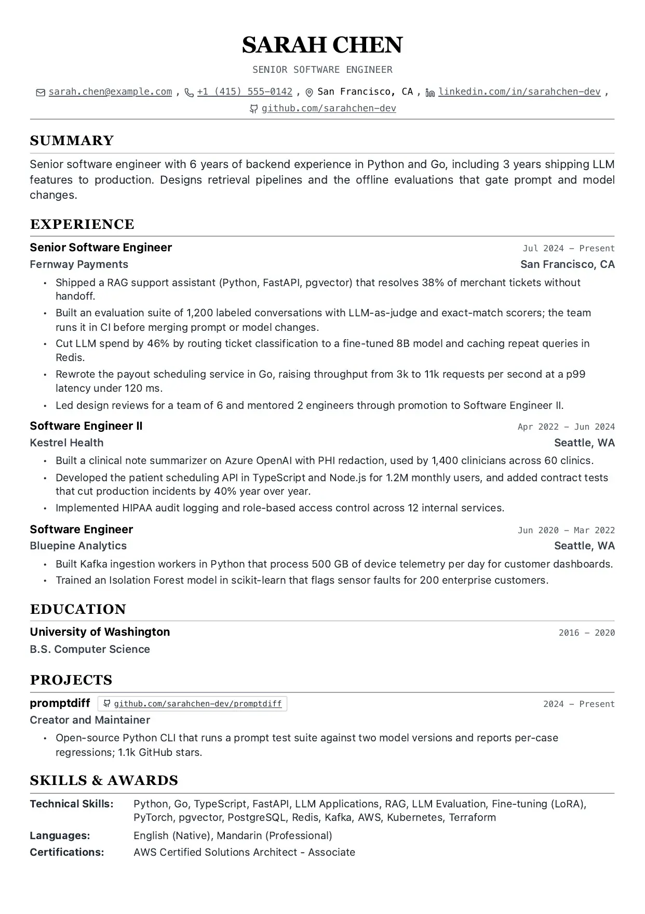 | 传统全宽布局，内容密度最高。[查看 PDF](assets/pdf-templates/single-column.pdf) |
| **双栏** | 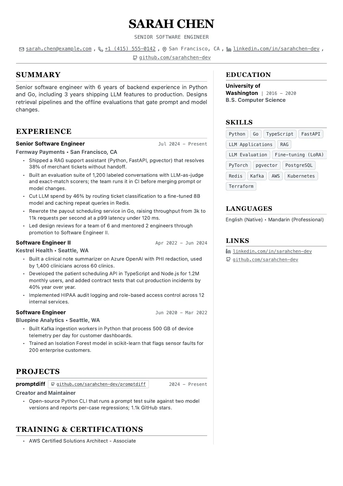 | 以经历为主的主栏布局，侧栏展示技能。[查看 PDF](assets/pdf-templates/two-column.pdf) |
| **现代** | 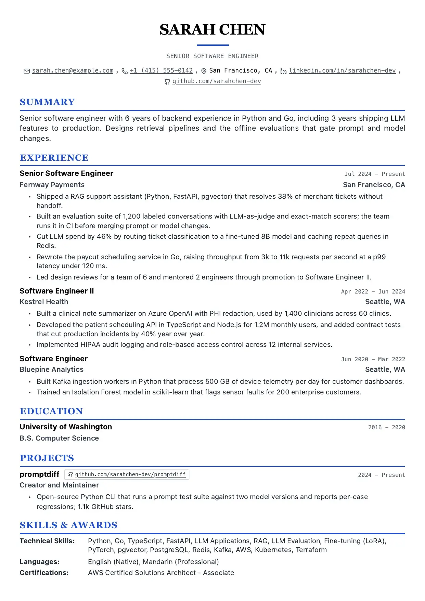 | 彩色点缀，支持自定义主题色。[查看 PDF](assets/pdf-templates/modern-single-column.pdf) |
| **现代双栏** | 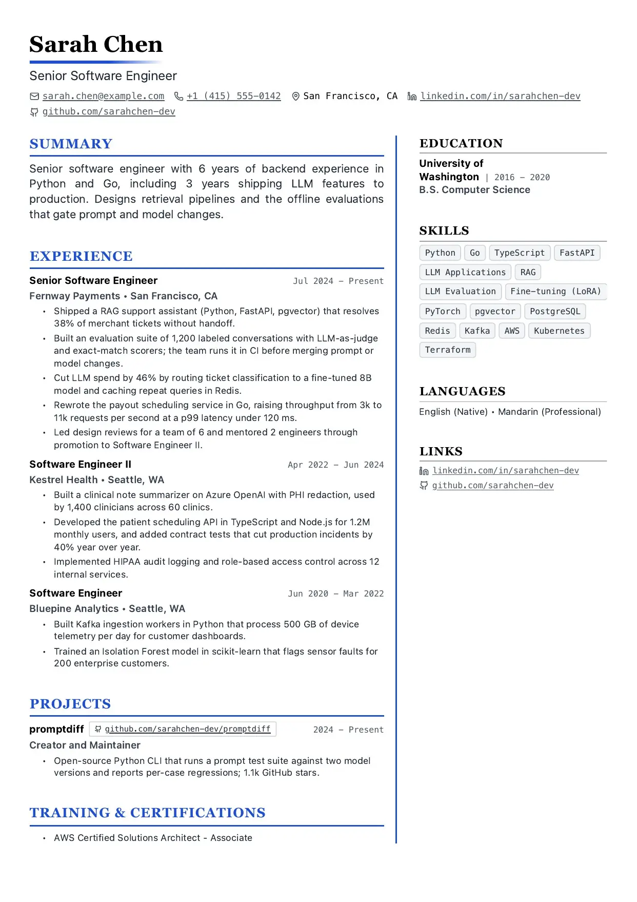 | 现代双栏布局，带彩色点缀与主题色。[查看 PDF](assets/pdf-templates/modern-two-column.pdf) |
| **LaTeX** | 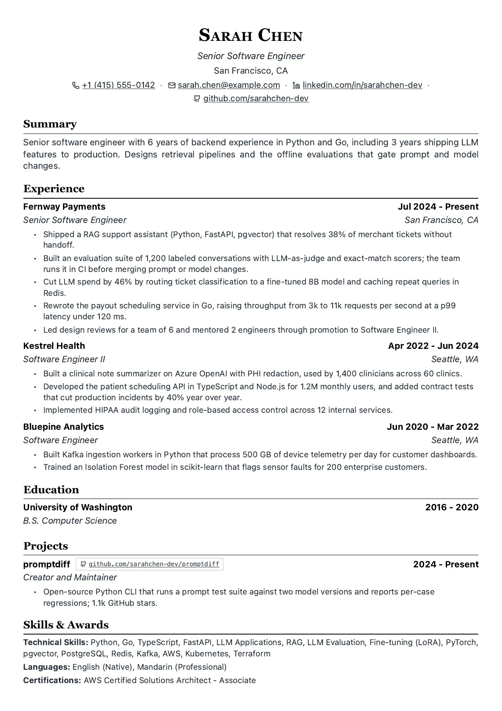 | 经典衬线学术版式，带分隔线的栏目标题。[查看 PDF](assets/pdf-templates/latex.pdf) |
| **简洁** | 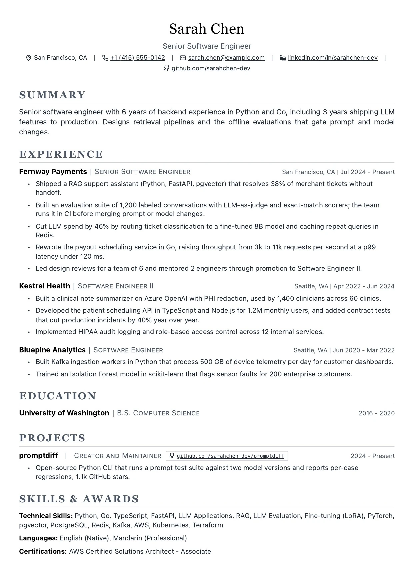 | 极简无衬线版式，栏目标题大而低调。[查看 PDF](assets/pdf-templates/clean.pdf) |
| **鲜明** | 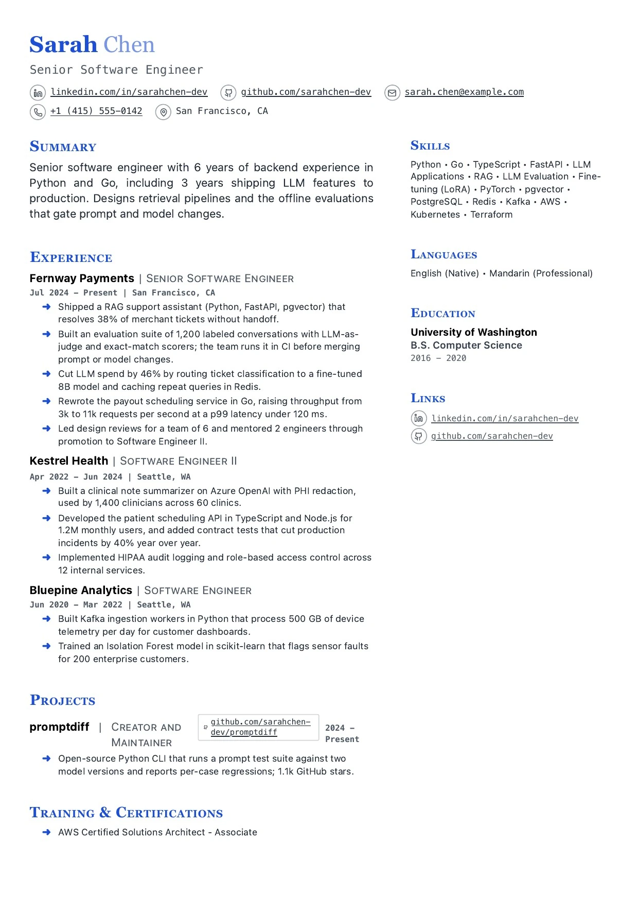 | 彩色双栏布局，强调色标题与箭头项目符号。[查看 PDF](assets/pdf-templates/vivid.pdf) |
| **鲜明单栏** | 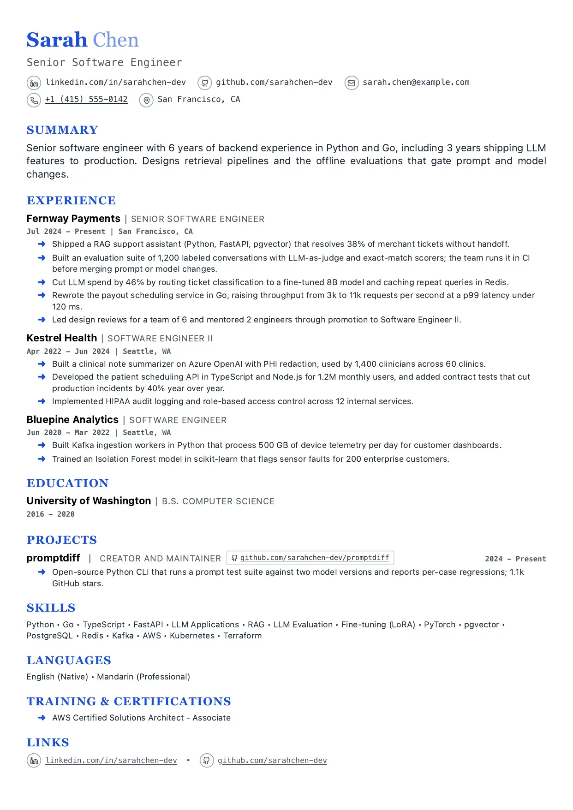 | 彩色单栏布局，强调色标题与箭头项目符号。[查看 PDF](assets/pdf-templates/vivid-single.pdf) |
| **Modern Deedy** | 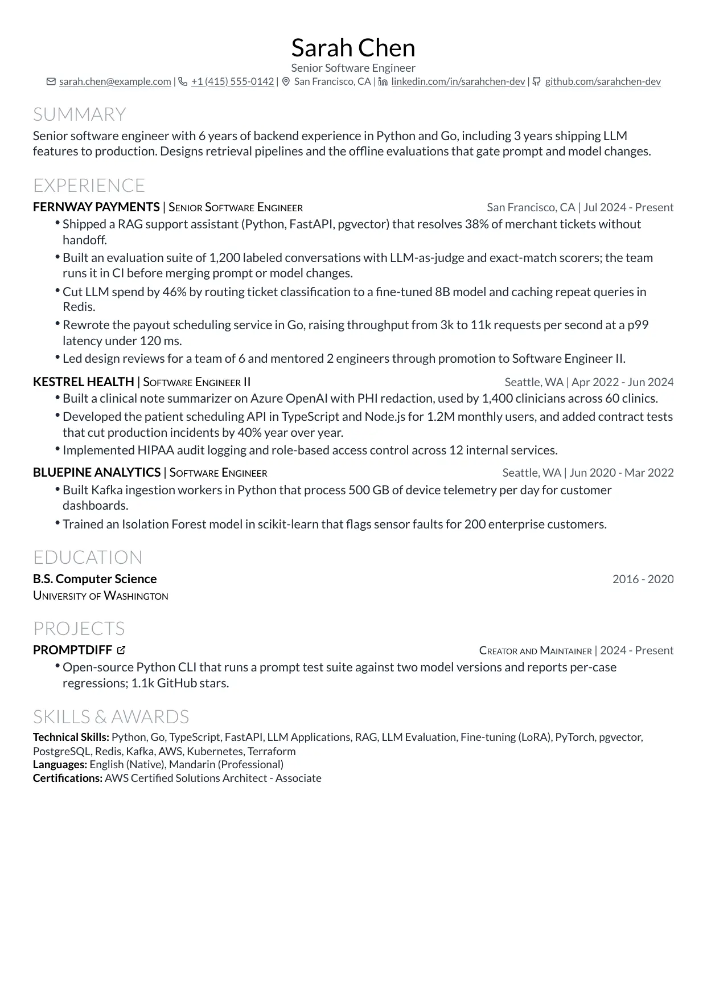 | Lato 字体的单页紧凑版式，栏目标题为浅灰色大写。[查看 PDF](assets/pdf-templates/modern-deedy.pdf) |
| **Deedy** | 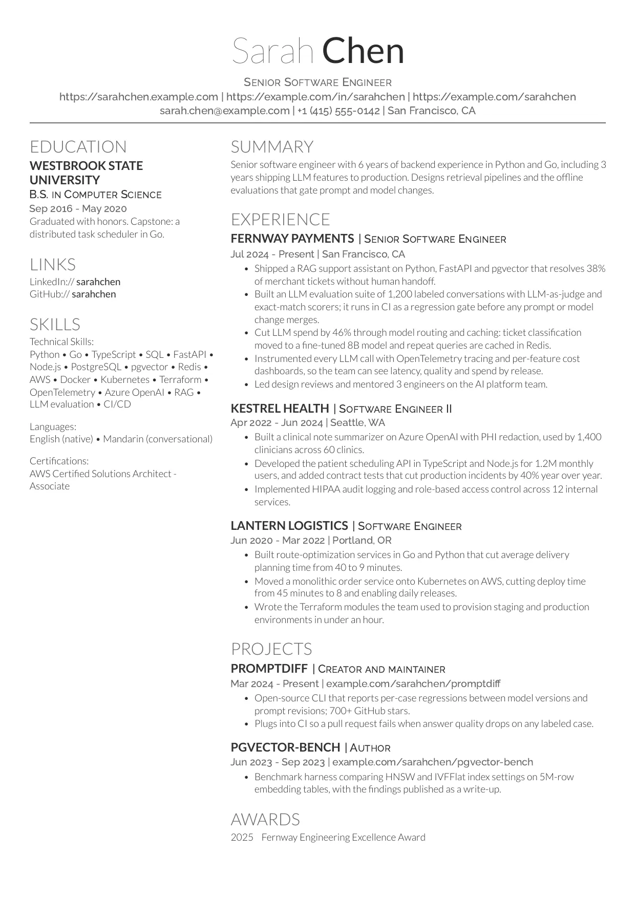 | 双栏布局，细体姓名、窄左栏与浅灰色标题。[查看 PDF](assets/pdf-templates/deedy.pdf) |

### 国际化

- **多语言 UI**：界面支持英语、西班牙语、中文、日语、巴西葡萄牙语、法语与韩语
- **多语言内容**：可按你偏好的语言生成简历与求职信

### 路线图

如果你有建议或功能需求，欢迎在 GitHub 提 Issue，或加入我们的 [Discord](https://dsc.gg/resume-matcher) 讨论。

- 可视化关键词高亮
- 用于打造量化、可落地简历内容的 AI 画布（AI Canvas）
- 多职位描述联合优化

## 软件工程师简历指南

[Resume Matcher 博客](https://resumematcher.fyi/zh/blog/)为开发者准备了简历写作指南，从第一份实习简历到 FAANG 投递：

- [软件工程师简历](https://resumematcher.fyi/zh/blog/software-engineer-resume/)：一页简历模板、两份带注解的范例和各部分写法
- [计算机专业简历](https://resumematcher.fyi/zh/blog/computer-science-resume/)：写给在校生和应届生，用项目和实习经历撑起简历
- [FAANG 简历](https://resumematcher.fyi/zh/blog/faang-resume/)：Google、Meta 和 Amazon 在自家招聘页面上说明的筛选标准
- [LaTeX 简历](https://resumematcher.fyi/zh/blog/latex-resume/)：Jake's、sb2nov 和 Awesome-CV 模板、Overleaf，以及解析器如何读取 PDF
- [开源简历生成器](https://resumematcher.fyi/zh/blog/open-source-resume-builders/)：Reactive Resume、RenderCV、YAMLResume、Awesome-CV 等工具对比
- [主简历](https://resumematcher.fyi/zh/blog/master-resume/)：一份完整的简历，每次投递都从它定制
- [根据职位描述定制简历](https://resumematcher.fyi/zh/blog/how-to-match-your-resume-to-a-job-description/)：分步骤的方法
- [用 Ollama 在本地私密定制简历](https://resumematcher.fyi/zh/blog/local-ai-resume-tailoring-ollama/)：简历始终留在你自己的电脑上
- [什么是 ATS 分数？](https://resumematcher.fyi/zh/blog/what-is-an-ats-score/)：简历检测工具怎么算分，附 Resume Matcher 的公式
- [用 ChatGPT 定制简历的提示词](https://resumematcher.fyi/zh/blog/tailor-resume-with-chatgpt-claude/)：适用于 ChatGPT 和 Claude、不编造经历的提示词

<a id="how-to-install"></a>

## 如何安装


更详细的安装与配置说明请查看 **[安装文档](SETUP.zh-CN.md)**（也提供 [English](SETUP.md) / [Español](SETUP.es.md) / [日本語](SETUP.ja.md)）。

### 前置条件

| 工具 | 版本 | 安装 |
|------|------|------|
| Python | 3.13+ | [python.org](https://python.org) |
| Node.js | 24+ | [nodejs.org](https://nodejs.org) |
| uv | 最新版 | [astral.sh/uv](https://docs.astral.sh/uv/getting-started/installation/) |

### 快速开始

适用于 MacOS、WSL 与 Ubuntu 的最快方式：

```bash
# 克隆仓库
git clone https://github.com/srbhr/Resume-Matcher.git
cd Resume-Matcher

# 后端（终端 1）
cd apps/backend
cp .env.example .env        # 配置你的 AI 提供商
uv sync                      # 安装依赖
uv run app

# 前端（终端 2）
cd apps/frontend
npm install
npm run dev
```

打开 **<http://localhost:3000>**，并在 Settings 中配置你的 AI 提供商。

### 支持的 AI 提供商

| 提供商 | 本地/云 | 说明 |
|--------|---------|------|
| **Ollama** | 本地 | 免费，在你的机器上运行 |
| **OpenAI** | 云 | GPT-4o、GPT-4o-mini |
| **Anthropic** | 云 | Claude 3.5 Sonnet |
| **Google Gemini** | 云 | Gemini 1.5 Flash/Pro |
| **OpenRouter** | 云 | 访问多种模型 |
| **DeepSeek** | 云 | DeepSeek Chat |

### Docker 部署

```bash
docker pull srbhr/resume-matcher:latest

docker run srbhr/resume-matcher:latest
```

<!-- 注意：Docker 文档正在编写中。目前请参考 docker-compose.yml -->

> **在 Docker 中使用 Ollama？** 将 Ollama URL 配置为 `http://host.docker.internal:11434`（而不是 `localhost`）。

### 技术栈

| 组件 | 技术 |
|------|------|
| 后端 | FastAPI、Python 3.13+、LiteLLM |
| 前端 | Next.js 15、React 19、TypeScript |
| 数据库 | TinyDB（JSON 文件存储） |
| 样式 | Tailwind CSS 4、Swiss International Style |
| PDF | Playwright 驱动的无头 Chromium |

## 参与贡献


我们欢迎所有人的贡献！无论你是开发者、设计师，还是希望帮忙的用户。所有贡献者都会展示在我们官网的 [about 页面](https://resumematcher.fyi/about/)，也会显示在 GitHub README 中。

如果你希望参与未来规划的功能，可以先看看路线图。若你有建议或功能需求，欢迎在 GitHub 提 Issue，并在我们的 [Discord](https://dsc.gg/resume-matcher) 讨论。

<a id="contributors"></a>

## 贡献者

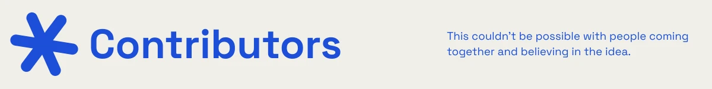

<a href="https://github.com/srbhr/Resume-Matcher/graphs/contributors">
  
</a>

<br/>

<details>
  <summary><kbd>Star 历史</kbd></summary>
  <picture>
    <source media="(prefers-color-scheme: dark)" srcset="https://star-history.dera.page/svg?repos=srbhr/resume-matcher&theme=dark&type=Date">
    
  </picture>
</details>

## Resume Matcher 是 [Vercel Open Source Program](https://vercel.com/oss) 的一部分


